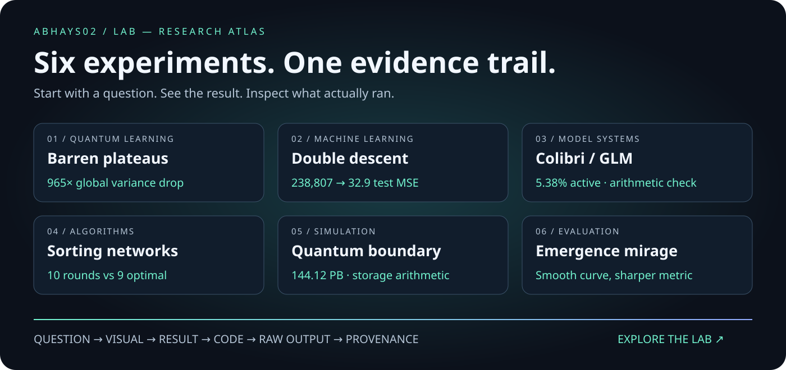

# ABHAYS02 / LAB

**Six questions. Visible results. Reproducible evidence.**

[**Enter the interactive lab →**](https://abhays02.github.io/lab/) ·
[Research notebook](docs/RESEARCH_NOTEBOOK.md) ·
[Windows downloads](https://github.com/abhays02/lab/releases)

<p align="center">
  <a href="https://abhays02.github.io/lab/"></a>
</p>

The website is the visual front door: explore a 3D-style research atlas, choose
an experiment, step through its workflow, and play or pause its explainer.
GitHub READMEs stay lightweight and readable—GitHub does not run interactive
JavaScript or 3D scenes inside Markdown.

## Choose a question

| # | Experiment | The question | The result |
|---|---|---|---|
| 01 | [Barren plateaus](barren-plateaus/) | Does the gradient survive as qubits increase? | **965×** global variance drop |
| 02 | [Double descent](double-descent/) | Why can one extra feature change test error so sharply? | **238,807 → 32.9** |
| 03 | [Colibri / GLM](colibri-glm/) | How much of a huge model is active per token? | **5.38% active**; ~**11 GB** implied reads, from published figures |
| 04 | [Sorting networks](sorting-network-depth/) | Can a correct sorting network still be too deep? | **10 vs 9** rounds at `n = 16` |
| 05 | [Quantum advantage boundary](quantum-advantage-boundary/) | Why does exact simulation hit a memory wall? | **144.12 PB** at 53 qubits |
| 06 | [Emergence mirage](emergence-mirage/) | Can a metric make a smooth curve look like a jump? | **Same curve, much sharper story** |

## Follow the evidence

**Question → visual → result → code → raw output → provenance.**
Each experiment README is the detailed guide; the notebook is the shared
index, not another copy of every guide.

| Label | Meaning |
|---|---|
| **Established** | Known before this run. |
| **Verified here** | Independently computed in this repo. |
| **Not claimed** | Not presented as a new scientific discovery. |

## Reproduce a run

Use Python 3.10 or newer. NumPy is required for barren plateaus, double
descent, quantum advantage boundary, and emergence mirage; Colibri's
arithmetic check and the sorting verifier use only the standard library.

```bash
python3 -m pip install numpy
```

| Experiment | Command from the repository root |
|---|---|
| Barren plateaus | `cd barren-plateaus && python3 barren.py` |
| Double descent | `cd double-descent && python3 double_descent.py` |
| Colibri / GLM arithmetic | `cd colibri-glm && python3 colibri_math.py` |
| Sorting-network verifier | `cd sorting-network-depth && python3 batcher_verify.py` |
| Quantum advantage boundary | `cd quantum-advantage-boundary && python3 rcs_verify.py` |
| Emergence mirage | `cd emergence-mirage && python3 emergence_mirage.py` |

Run each script from its experiment folder so generated outputs stay beside
their evidence. Scripts that write JSON replace that folder's result file.
The Colibri script checks arithmetic against published inputs; it does not
run or benchmark the 372 GB model.

The checked-in GIFs and their motion-free final-frame previews can be
regenerated from the committed JSON artifacts:

```bash
python3 -m pip install -r requirements-visuals.txt
python3 scripts/generate_visual_gifs.py
```

## Website and Windows

Preview the dependency-free website locally:

```bash
python3 scripts/build_site.py
python3 scripts/desktop.py
```

The launcher serves only the assembled public site on a loopback address and
opens your browser. Keep its terminal open; press Ctrl+C to stop.

- **Pages:** the independent [publishing workflow](.github/workflows/docs.yml)
  deploys after changes reach `main`; select **GitHub Actions** in repository
  **Settings → Pages** first.
- **Windows:** the [Windows workflow](.github/workflows/windows-release.yml)
  builds and smoke-tests an offline `Lab-Explorer.exe`. Run it manually for an
  artifact, or push a `v*` tag for a GitHub Release with SHA-256 checksums.
- **Setup:** [publishing, custom domain, and release instructions](docs/RESEARCH_NOTEBOOK.md#publishing-and-distribution).

The Windows app explores bundled results; it does not run the experiments or
install a model. It is unsigned, so Windows may show a SmartScreen warning.
Downloads become available only after a successful Windows workflow.
