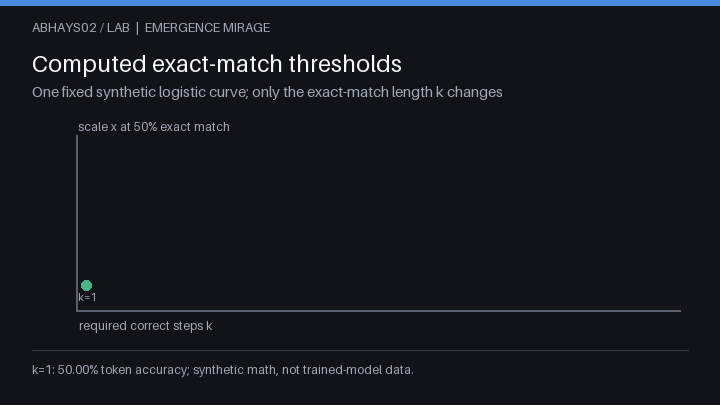

# Emergence mirage

<p align="center">
  
</p>

<p align="center"><em>Synthetic logistic calculation, not trained-model data.</em> · <a href="visual.svg">Static SVG fallback</a></p>

## 01. The question

> **Can the scoring rule make a smooth capability curve look like a sudden breakthrough?**

```text
ONE UNDERLYING CURVE
        │
        ├── score 1 step    → gradual
        ├── score 20 steps  → sharper
        └── score 100 steps → looks like a jump
```

Nothing about the underlying model curve changes.

## 02. The setup

| Part | Choice |
|---|---|
| Underlying capability | Smooth logistic curve |
| Training | None |
| External data | None |
| Scoring rule | Exact match over `k` steps |
| `k` tested | 1, 5, 20, 50, 100 |

## 03. The result

| Steps `k` | Per-token accuracy for 50% exact match | Apparent crossing |
|---:|---:|---:|
| 1 | 50.00% | 5.00 |
| 5 | 87.06% | 6.59 |
| 20 | 96.59% | 7.79 |
| 50 | 98.62% | 8.56 |
| 100 | **99.31%** | **9.14** |

```text
more required steps
        ↓
more tokens must be right at once
        ↓
exact-match curve gets steeper
        ↓
“emergence” looks more abrupt
```

## 04. What this answers

**A nonlinear metric can manufacture a strong appearance of a phase-like jump from a smooth underlying capability curve.**

## 05. What this does not answer

This experiment does **not** show that every real-world emergent ability is a metric artifact.

It isolates one mechanism and measures it exactly.

## 06. What is established vs verified

| Layer | Answer |
|---|---|
| Established | The exact-match metric artifact is known in prior work. |
| Verified here | The mechanism and its scaling with `k`. |
| Not claimed | A universal explanation for all emergent abilities. |

## 07. Evidence path

```text
SMOOTH CURVE
    ↓
emergence_mirage.py
    ↓
emergence_results.json
    ↓
visual.svg
    ↓
compute.md
```

[Visual](visual.svg) · [Experiment](emergence_mirage.py) · [Results](emergence_results.json) · [Evidence](compute.md)

## Reproduce

Requires Python 3.10+ and NumPy. From this folder, run
`python3 emergence_mirage.py` to print the deterministic calculation. The
checked-in `emergence_results.json` contains its reported threshold values.

[Back to the lab](../)
