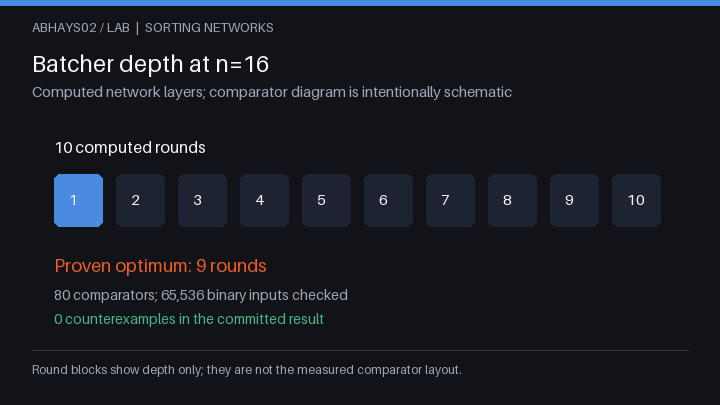

# Sorting network depth

<p align="center">
  
</p>

<p align="center"><em>Round blocks show depth only, not the comparator layout.</em> · <a href="frame.png">Static image fallback</a></p>

## 01. The question

> **Can a classic sorting network be correct and still use more parallel rounds than necessary?**

```text
inputs
  ↓
compare / swap
  ↓
parallel layers
  ↓
sorted output
```

The experiment measures both correctness and depth.

## 02. The key comparison

| Inputs | Batcher depth | Proven optimum / best known | Gap |
|---:|---:|---:|---:|
| 16 | **10** | **9** | 1 round |
| 17 | 10 | 10 | 0 |
| 28 | 13 | best known: 13 | not proven optimal |

## 03. What I verified

```text
Batcher construction
        ↓
80 comparators at n = 16
        ↓
10 parallel layers
        ↓
all 2^16 binary inputs checked
        ↓
0 counterexamples
```

## 04. What this answers

**The textbook construction sorts correctly, but at `n = 16` it is one parallel round deeper than the proven optimum.**

That distinction matters:

```text
CORRECT ≠ OPTIMAL DEPTH
```

## 05. What is established vs computed

| Layer | Answer |
|---|---|
| Established | Batcher's construction and the proven optimum are prior results. |
| Verified here | Comparator count, layer count, and exhaustive 0/1 correctness for `n ≤ 16`. |
| Not claimed | A new optimal sorting network. |

## 06. Why the check is useful

The 0/1 principle turns a huge real-valued correctness space into a finite exhaustive test.

```text
all real inputs
      ↓
0 / 1 principle
      ↓
all binary inputs
      ↓
exhaustive verification
```

## 07. Evidence path

[Animated visual](visual.html) · [Verifier](batcher_verify.py) · [Results](batcher_results.json) · [Evidence](compute.md)

## Reproduce

Requires Python 3.10+ and only the standard library. From this folder, run
`python3 batcher_verify.py`; it checks the 0/1 principle for sizes through
16 and writes `batcher_results.json` beside the script.

[Back to the lab](../)
